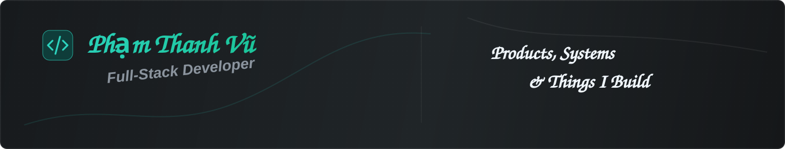

  

<table>
  <tr>
    <td width="30%" align="center" valign="middle">
      
       
      <h2>Thanh Vu</h2>
      
<code>@vupham132</code>

    </td>
    <td width="70%" valign="middle">
      <h1>Hi, I'm Thanh Vu 👋</h1>
      <h3>Full-Stack Developer</h3>
      
I build production web platforms across education, operations, field sales, HR, and tourism. My work spans frontend applications, backend APIs, business workflows, permissions, reporting, integrations, and testing.

      

        
        
        
      

    </td>
  </tr>
</table>

## What I work with

  

## Selected projects

> Click a project to open its case study. Production repositories are private, so these pages explain the product, architecture, and engineering scope without exposing source code.

<table>
  <tr>
    <td width="50%" valign="top">
      <h3><a href="./projects/trung-tam-thanh-hang.md">🏫 Trung Tâm Thanh Hằng →</a></h3>
      
End-to-end education-center operations: CRM, enrollment, classes, attendance, finance, HR, inventory, teacher/student portals, and e-learning.

      
<code>Next.js</code> <code>TypeScript</code> <code>MUI</code> <code>Laravel</code>

      
<a href="./projects/trung-tam-thanh-hang.md"><strong>View case study →</strong></a>

    </td>
    <td width="50%" valign="top">
      <h3><a href="./projects/speak-with-hang.md">🗣️ Speak With Hằng →</a></h3>
      
English-learning and content platform with courses, video lessons, enrollment, orders, payments, CMS, roadmaps, and notifications.

      
<code>Next.js</code> <code>Tailwind</code> <code>Radix UI</code> <code>Laravel</code>

      
<a href="./projects/speak-with-hang.md"><strong>View case study →</strong></a>

    </td>
  </tr>
  <tr>
    <td width="50%" valign="top">
      <h3><a href="./projects/kimcom-field-sales.md">📋 Kimcom Field Sales PM →</a></h3>
      
Field-sales operations for projects, teams, shifts, sampling, stock, orders, promotions, gifts, evidence photos, and reporting.

      
<code>React</code> <code>Vite</code> <code>Laravel</code> <code>Redis</code> <code>Reverb</code>

      
<a href="./projects/kimcom-field-sales.md"><strong>View case study →</strong></a>

    </td>
    <td width="50%" valign="top">
      <h3><a href="./projects/hr-kim.md">👥 HR-KIM →</a></h3>
      
Independent HR and payroll platform with SSO, RBAC, employee records, contracts, attendance conversion, payroll closing, and DOCX generation.

      
<code>React</code> <code>Vite</code> <code>Laravel 11</code> <code>95 tests</code>

      
<a href="./projects/hr-kim.md"><strong>View case study →</strong></a>

    </td>
  </tr>
  <tr>
    <td width="50%" valign="top">
      <h3><a href="./projects/ielts-hana.md">🎓 IELTS Hana / WA P061 →</a></h3>
      
Education management for curricula, schedules, attendance, assignments, grading, tuition, payroll, documents, and permissions.

      
<code>React</code> <code>MUI</code> <code>Zustand</code> <code>Laravel</code>

      
<a href="./projects/ielts-hana.md"><strong>View case study →</strong></a>

    </td>
    <td width="50%" valign="top">
      <h3><a href="./projects/ninh-binh-tourism.md">🌏 Ninh Bình Tourism →</a></h3>
      
Multilingual tourism discovery with listings, search, guides, itineraries, members, bookings, paid content, analytics, and administration.

      
<code>React</code> <code>Fastify</code> <code>PostgreSQL</code> <code>i18next</code>

      
<a href="./projects/ninh-binh-tourism.md"><strong>View case study →</strong></a>

    </td>
  </tr>
</table>

## Engineering focus

- Full-stack feature delivery across UI, API, data models, validation, and authorization
- Complex business workflows, approval flows, RBAC, audit logs, and data integrity
- Dashboards, reports, Excel/Word import-export, media pipelines, and third-party integrations
- Testing with Vitest, Playwright, PHPUnit, and Pest
- Maintainable modular architectures for long-running business products

  <i>Build useful products. Solve real workflows. Keep learning.</i>

<!-- Add LinkedIn here after confirming what should be public. -->
